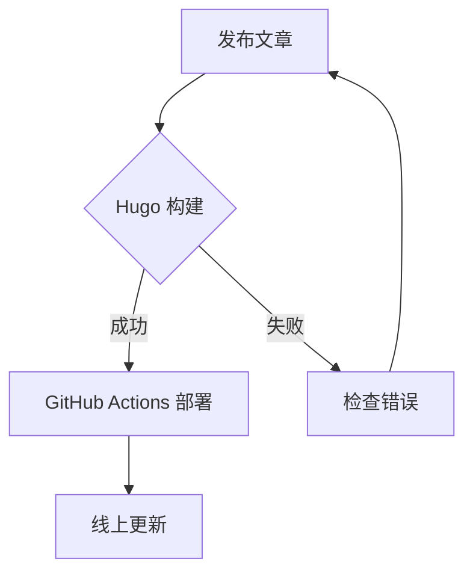

这篇文章演示 HugoBlox 博客的几个常用写作特性：**代码高亮**、**LaTeX 数学公式** 与 **Mermaid 图表**。

## 代码高亮

```python
def fibonacci(n: int) -> int:
    """返回斐波那契数列的第 n 项。"""
    a, b = 0, 1
    for _ in range(n):
        a, b = b, a + b
    return a

print(fibonacci(10))  # 55
```

## LaTeX 数学公式

行内公式：$E = mc^2$

块级公式：

$$f(x) = \int_{-\infty}^{\infty} \hat f(\xi)\,e^{2\pi i \xi x}\,d\xi$$

## Mermaid 流程图



## 表格

| 功能 | 支持情况 |
| --- | --- |
| 代码高亮 | ✅ |
| 数学公式 | ✅ |
| Mermaid 图表 | ✅ |
| 标签分类 | ✅ |

以上就是 HugoBlox 博客的主要写作特性，上手非常简单！